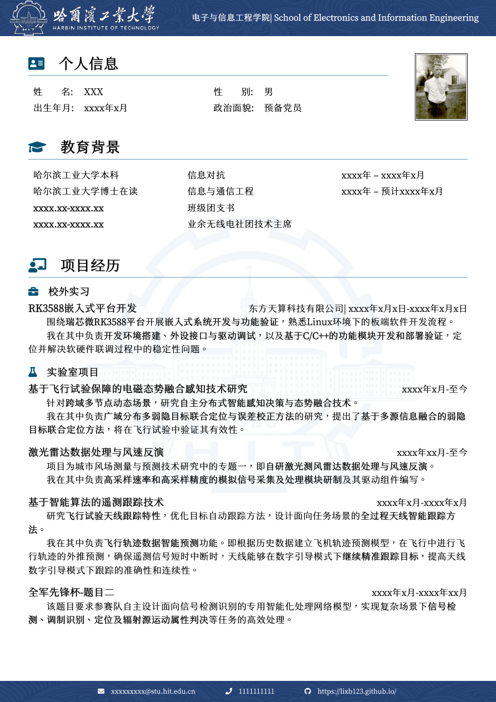
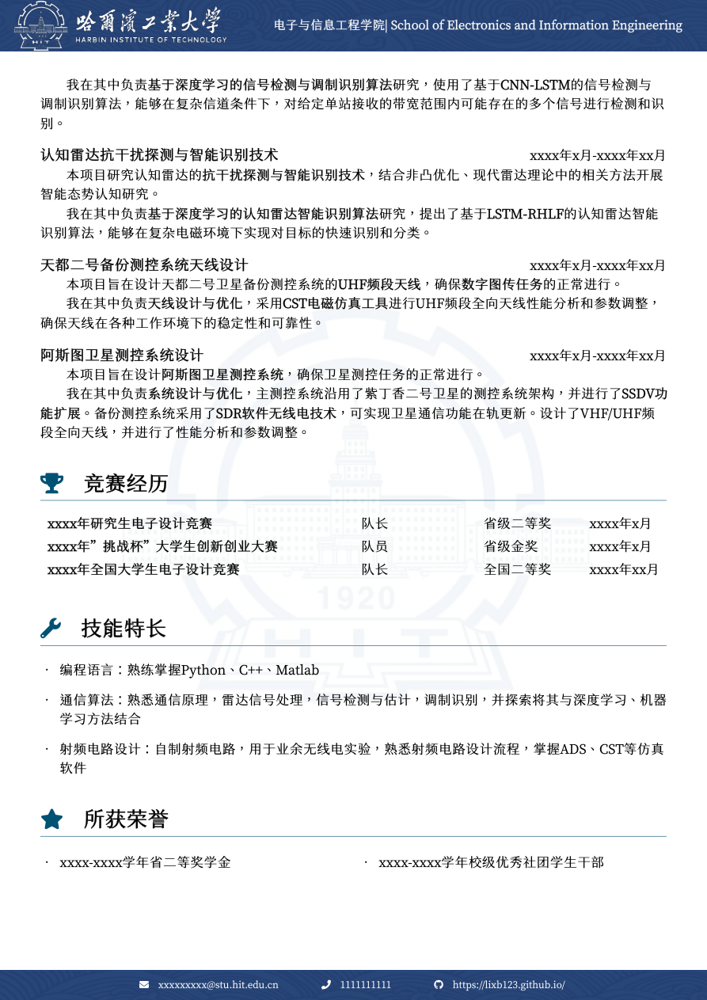

# HIT 中文简历 LaTeX 模板

基于 XeLaTeX 的哈尔滨工业大学中文简历模板。模板使用校徽页眉、页脚和水印，并提供项目经历、教育背景、竞赛经历、技能特长与荣誉等常用模块。

[查看示例 PDF](./main.pdf)





## 环境要求

- Git（可选，用于克隆仓库）
- TeX Live 或 MiKTeX，且必须包含 `xelatex`
- 系统安装字体：仓库中 `fonts/` 目录提供的狮尾四季春字体
- Windows 下建议使用 PowerShell；编辑器建议使用 VS Code 和 LaTeX Workshop

模板依赖 `xeCJK`、`fontspec`、`fontawesome5`、`tikz`、`titlesec`、`tabularx`、`enumitem`、`multicol` 等宏包。TeX Live 的完整安装默认包含这些宏包；MiKTeX 可在首次编译时按提示安装缺失包。

## 快速开始

1. 获取项目：

   ```powershell
   git clone https://github.com/lixb123/hit-jl-zh.git
   Set-Location hit-jl-zh
   ```

   也可以下载 ZIP 文件并解压。

2. 安装字体：打开 `fonts/SweiSpring.ttf` 与 `fonts/SweiSpring Bold.ttf`，在 Windows 字体预览窗口中选择“安装”。安装后重启 VS Code 或终端，使 XeLaTeX 能识别字体。

3. 检查 XeLaTeX 是否可用：

   ```powershell
   xelatex --version
   ```

4. 编辑内容：

   - 在 `main.tex` 中填写个人信息、教育背景与经历
   - 用自己的照片替换 `images/avatar.png`
   - 需要调整全局字体、标题、页面尺寸或主题色时，编辑 `settings.tex`

5. 连续编译两次以生成稳定的书签和交叉引用：

   ```powershell
   xelatex -interaction=nonstopmode main.tex
   xelatex -interaction=nonstopmode main.tex
   ```

   成功后会在项目根目录生成 `main.pdf`。

## 使用构建脚本

项目提供 PowerShell 脚本，可完成两次 XeLaTeX 编译：

```powershell
.\buildpdf.ps1
```

脚本在编译完成后会询问是否删除临时文件。直接按 Enter 会删除 `.aux`、`.log` 等临时文件；若要保留日志用于排错，请按 `Ctrl+C` 终止该提示。

如果本机的 PowerShell 执行策略阻止运行脚本，可仅对当前终端临时放行：

```powershell
Set-ExecutionPolicy -Scope Process Bypass
.\buildpdf.ps1
```

## VS Code 使用方式

1. 安装 LaTeX Workshop 扩展。
2. 用 VS Code 打开本仓库根目录。
3. 打开 `main.tex`，选择 LaTeX Workshop 的构建命令，并确保编译器为 XeLaTeX。
4. 在 PDF 预览窗口查看生成结果。

若扩展默认使用 pdfLaTeX，请在 LaTeX Workshop 设置中将构建配方切换为 XeLaTeX；pdfLaTeX 无法正确处理本模板的中文字体配置。

## 常见问题

### `xelatex` 不是内部或外部命令

安装 TeX Live 或 MiKTeX 后重启终端，确认其安装目录已加入 `PATH`，然后重新运行 `xelatex --version`。

### 找不到 `獅尾四季春加糖` 字体

重新安装 `fonts/` 中的两个字体文件并重启 VS Code/终端。该字体名由字体文件内部元数据提供，文件名不需要修改。

### 缺少 LaTeX 宏包

TeX Live 可使用其包管理工具安装缺失宏包；MiKTeX 可在其设置中启用“缺失包自动安装”，或在弹窗中确认安装后再次编译。

### 修改后 PDF 没有刷新

从项目根目录连续运行两次 XeLaTeX 命令。若仍有问题，删除 `main.aux`、`main.log` 等中间文件后重新编译，或使用 `buildpdf.ps1` 并在提示时按 Enter 清理。

## 文件说明

| 路径 | 作用 |
| --- | --- |
| `main.tex` | 简历正文与个人内容 |
| `settings.tex` | 宏包、字体、页面、标题与主题样式 |
| `buildpdf.ps1` | Windows PowerShell 构建脚本 |
| `fonts/` | 模板所需的狮尾四季春字体文件 |
| `images/` | 页眉、页脚、校徽、水印与头像资源 |
| `main.pdf` | 最新编译出的简历 PDF |

## 致谢

本模板基于[西北工业大学中文 CV 模板](https://www.overleaf.com/latex/templates/npu-cv/mncqzxhvfzrx)和[北京邮电大学 BUPT 简历模板](https://github.com/Yokumii/BUPT-CV-Template)调整而来。

字体使用[狮尾四季春](https://github.com/max32002/swei-spring)，感谢原作者。

## 示例信息与图片来源

示例中的学号、邮箱用户名和日期数字使用等长的 `x` 占位，邮箱保留 `@` 后的完整域名。

示例照片为克劳德·香农，来源：[Wikimedia Commons — Claude Shannon c1930.png](https://commons.wikimedia.org/wiki/File:Claude_Shannon_c1930.png)（页面注明来源为密歇根大学 Bentley Historical Library，公有领域）。照片仅用于展示模板。
